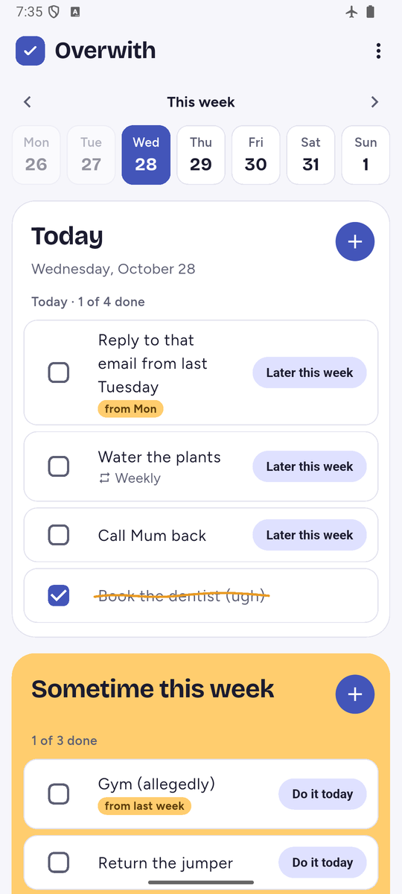
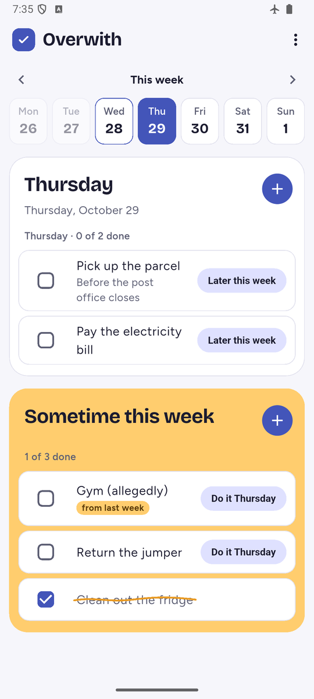
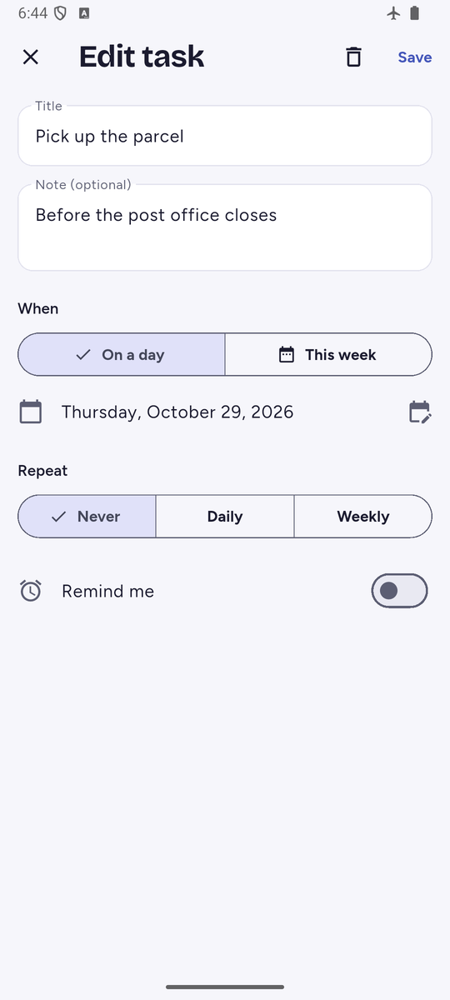
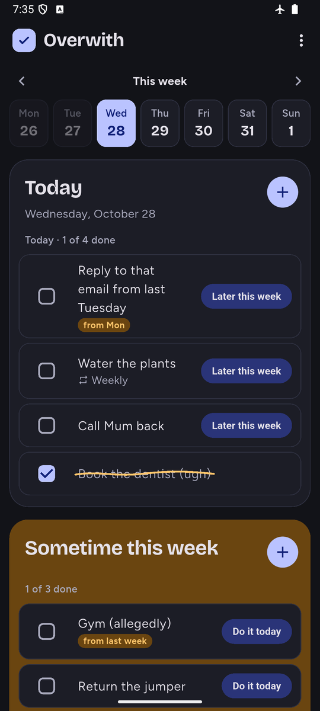

# Overwith

A Flutter task manager for Android and iOS, for planning what to do today and across the week. Tasks can be due on a specific day or "sometime this week", and they can repeat and send reminders. Everything is stored on the device.

Website: [overwith.app](https://overwith.app) · [Privacy policy](https://overwith.app/privacy) · [Support](https://overwith.app/support)

> **The source code is private.** This page shows the project's features, design and engineering approach. Code access is available on request.

<p align="center">
  
  
  
  
</p>

## Features

- **One screen**: Monday to Sunday buttons along the top, a card for the chosen day, and an amber card for "sometime this week" tasks. Each card has its own + button and a done count.
- **Pick a day or a week**: tap a day button to see that day's tasks, and tap today's button to go back to Today. Arrows move a week at a time.
- **Move in one tap**: "Later this week" moves a day task to the week card, and "Do it today" (or the chosen day) moves a week task to that day.
- **Finished tasks stay**, crossed out with a hand-drawn line, in both cards.
- **Day or week tasks**: give a task a specific date, or just the week it belongs to.
- **Repeating tasks**: when you tick off a daily or weekly task, the next copy is created automatically, with its reminder moved forward.
- **Roll-forward**: unfinished tasks from past days move to today automatically, and "sometime this week" tasks move to the current week. Weekly tasks keep their weekday, and missed repeats don't pile up. A small "from Mon" tag shows where a carried task started.
- **Reminders**: local notifications at a time you choose. The app asks for notification permission the first time you turn one on. On a locked phone set to hide sensitive content, the task name is hidden.
- **Quick editing**: tap a task to edit it, tick it off with the checkbox, or swipe left to delete it (with Undo).
- **Sounds and messages**: a tick, a vibration and a cheeky message when you tick a task off, a ta-da when a list is finished, and a "nope" when you delete one. Sound can be turned off.
- **Offline**: tasks are saved in SQLite and settings in the app's own storage, both on the device. There's no account or server.
- **Dark and light mode**: dark by default, with a switch in the ⋮ menu.
- **Same look as the website**: the colours, fonts and check-mark logo of [overwith.app](https://overwith.app), also used as the app icon.
- **About screen** with the open-source licenses of the packages the app uses.

## Tech stack

| Area | Choice |
| --- | --- |
| Framework | Flutter 3.47 / Dart 3.13 |
| UI | Material 3 |
| State | `ChangeNotifier` and `InheritedNotifier` (built into Flutter, no extra package) |
| Storage | SQLite via `sqflite` for tasks; `shared_preferences` for settings |
| Sound | `audioplayers`, with sound files generated from the website's notes |
| Fonts | Bricolage Grotesque, Figtree and Caveat (SIL Open Font License), bundled with the app |
| Notifications | `flutter_local_notifications` and `timezone` |
| Testing | `flutter_test` with `sqflite_common_ffi` for fast tests on a computer; `integration_test` for end-to-end tests on a real device |
| CI | GitHub Actions (`flutter analyze` and `flutter test` on every push and pull request) |

## Architecture

```
Screens ──read & listen──▶ TaskStore ──save──▶ TaskDatabase (SQLite)
                              │
                              └──schedule/cancel──▶ ReminderScheduler (notifications)
```

The app has four layers, each with one job:

| Layer | Responsibility |
| --- | --- |
| **Model** | The `Task` class, date helpers, and recurrence rules (pure Dart, no Flutter) |
| **Data** | One SQLite table and the queries for "today" and "this week", with versioned upgrades that keep existing tasks |
| **State** | `TaskStore`, the single source of truth that every screen reads from |
| **UI** | One main screen (day buttons, a day card and a week card), the add/edit form, and reusable task rows |

Screens never talk to the database directly. Every change goes through `TaskStore`, which saves it, updates its list of tasks in memory, tells the screens to redraw, and schedules or cancels the task's reminder.

## Design decisions

- **Built-in state management, no extra package.** Flutter's own `ChangeNotifier` was enough for one shared store and kept the app simple and easy to follow.
- **Week tasks are stored on the Monday of their week.** That lets one date-range query return everything in a week, both day tasks and "sometime this week" tasks.
- **Dates are moved by calendar day, not by 24 hours.** Adding a fixed 24 hours can shift a time by an hour across daylight-saving changes, so repeating tasks and reminders move by calendar day instead.
- **Reminders sit behind an interface.** The store depends on a `ReminderScheduler` interface rather than the notification plugin directly, so tests use a fake scheduler, and a notification failure can never stop a task from being saved.
- **Reminders are rebuilt at every launch.** All scheduled reminders are cleared and recreated from the database on start-up, so they can't drift out of sync.
- **Inexact alarms on Android.** Reminders may arrive a few minutes late, but the app avoids Google Play's restricted "exact alarm" permission.
- **Missed tasks catch up once, not many times.** If a daily task is missed for three days, it shows up once today rather than three times. The check runs when the app opens and again when it comes back to the front, in case the day changed while it was open.
- **Permissions are asked for in context.** Notification permission is requested the first time a reminder is turned on, not when the app launches.
- **Database upgrades keep every task.** Adding the "from Mon" tag needed a new column, so the database is versioned and upgrades in place. A test builds an old-version database and checks that its tasks survive.
- **Sounds that stay out of the way.** Sounds play alongside music instead of pausing it, stay quiet when the phone is on silent, and can be turned off. They're generated from the same notes the website plays, so app and site sound alike.
- **One design for app and website.** The colours, fonts and logo are shared, and the app's empty states and messages use the website's words.

## Testing and quality

- **106 automated tests** across four levels:
  - model rules (dates, recurrence, moving tasks, validation)
  - database queries and upgrades against SQLite
  - store and settings behaviour, with a fake reminder scheduler and a fake sound player
  - widget tests that drive the real screens: adding, editing, deleting, ticking off, picking days and weeks, moving tasks, and the sound switch
- **Static analysis** with Flutter's recommended lint rules; the analyzer reports no issues.
- **End-to-end tests** run the real app on an Android 36 emulator, with the real database and the real notification system. They add, tick off, edit and delete tasks, pick days and weeks, and restart the app to check that everything was saved. They also check that a task left over from an earlier day moves to today, with its "from" date, in the real database, and that reminders are scheduled with Android and cancelled again. Testing caught real problems before release: two "add" buttons that conflicted during screen transitions, and a sound library that kept redrawing the screen after every sound, which would have drained the battery.
- **Continuous integration** runs the analyzer and the unit and widget tests on every push and pull request. All changes go through pull requests that must pass CI.
- **Checks before merging**: the analyzer, the unit and widget tests and the end-to-end tests must all pass before a change is merged into `main`. A pull request template keeps this checklist.

## Privacy and security

- **No network access**: the release build doesn't request internet permission.
- **No accounts or tracking**: tasks stay on the device.
- **Private lock-screen reminders**: the task name is hidden when the phone is set to hide sensitive content.
- **Published privacy policy** at [overwith.app/privacy](https://overwith.app/privacy).
- **Parameterised SQL queries**: text typed into a task can't be used to attack the database (no SQL injection).
- **Locked-down notification receivers**: other apps can't trigger them.
- **Read-only CI permissions**: the build pipeline can read the code but can't change it.
- **Dependabot**: dependencies are checked weekly, and each update arrives as a pull request that CI tests. Security alerts and automatic security fixes are turned on.

## What's next

- Build and test the iOS version
- Add a release signing key
- Publish on Google Play and the App Store

## About this project

I built Overwith to plan my days and the weeks ahead in one place, and as a hands-on way to learn Flutter app development from start to finish. Along the way I practised structuring an app around a single source of state, storing data locally with SQLite, scheduling notifications, writing unit and widget tests, and running them automatically with GitHub Actions.

---

© 2026 Bron222. All rights reserved. Screenshots and text on this page may not be reused without permission.
